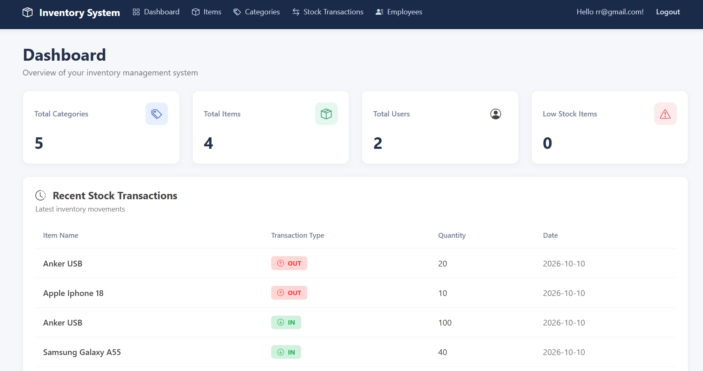
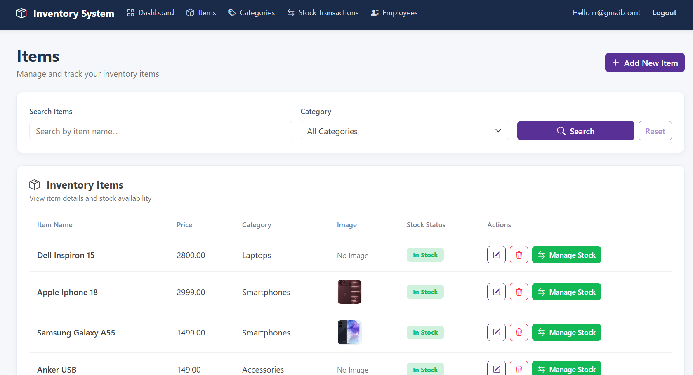
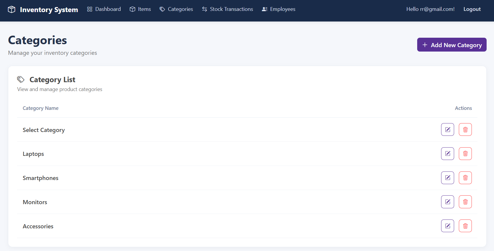
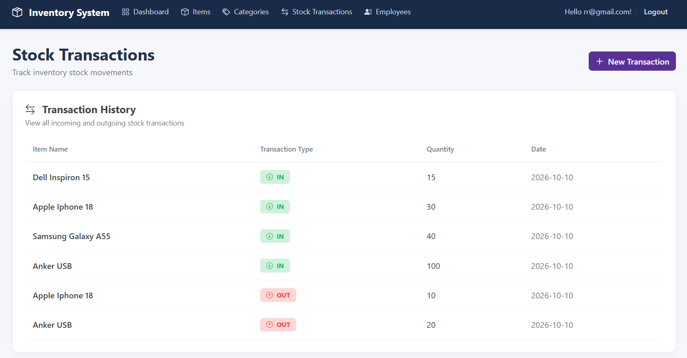
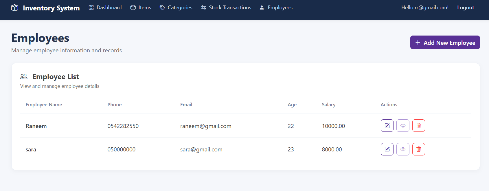

# Inventory Management System 

A web-based Inventory Management System built using ASP.NET Core MVC, Entity Framework Core, and SQL Server.

The system helps manage inventory items, categories, employees, and stock transactions through a simple and user-friendly interface.

## Features

- Dashboard: Displays inventory statistics, low-stock items, and recent stock transactions.
- Item Management: Add, edit, delete, and view inventory items with image uploads.
- Category Management: Create, update, and delete product categories.
- Stock Transactions: Record incoming (IN) and outgoing (OUT) stock movements.
- Stock Monitoring: Track available quantities and identify low-stock or out-of-stock items.
- Employee Management: Manage employee information.
- Authentication: Secure login and registration using ASP.NET Core Identity.
- Role-Based Authorization: Different permissions for Admin and Employee users.

## Technologies Used

- ASP.NET Core MVC
- C#
- Entity Framework Core
- SQL Server LocalDB
- ASP.NET Core Identity
- Bootstrap 5
- HTML, CSS, JavaScript
- Repository Pattern & Unit of Work

## User Roles

### Admin
- Manage items and categories.
- Manage employees.
- View inventory statistics.
- Record stock transactions.

### Employee
- View items and categories.
- Record stock transactions.
- View inventory dashboard.

## Getting Started

1. Clone the repository.
2. Open TestWebApplication.sln in Visual Studio.
3. Update the connection string in appsettings.json if necessary.
4. Open Package Manager Console and run:

  
   Update-Database
   
5. Run the application using Visual Studio.
6. Register or sign in to access the system.

## Screenshots

### Dashboard

### Items

### Categories

### Stock Transactions

### Employees

## Project Purpose

This project was developed to practice ASP.NET Core MVC, database management, authentication, authorization, and building a complete CRUD-based web application.